

**UNIVERSIDADE DE MOGI DAS CRUZES**

&nbsp;

**BEATRIZ TEIXEIRA MIGUEL** 
**JHONATHAN SILVA TONELLO** 
**VINICIUS RODRIGUES ALMEIDA ALVES**

&nbsp;

&nbsp;

&nbsp;

**ESTEIRA AUTOMATIZADA DE DEVSECOPS COM GITHUB ACTIONS NO PROJETO NIVELA: VARREDURA DE SEGREDOS, ANÁLISE DE DEPENDÊNCIAS E ANÁLISE ESTÁTICA DE SEGURANÇA**

&nbsp;

*Relatório Técnico – Atividade DevOps2*

&nbsp;

&nbsp;

&nbsp;

Repositório: https://github.com/Projeto-Integrador2026/Projeto_Nivela.github/tree/main

&nbsp;

&nbsp;

**Mogi das Cruzes** 
**2026**

**BEATRIZ TEIXEIRA MIGUEL** 
**JHONATHAN SILVA TONELLO** 
**VINICIUS RODRIGUES ALMEIDA ALVES**

&nbsp;

**ESTEIRA AUTOMATIZADA DE DEVSECOPS COM GITHUB ACTIONS NO PROJETO NIVELA: VARREDURA DE SEGREDOS, ANÁLISE DE DEPENDÊNCIAS E ANÁLISE ESTÁTICA DE SEGURANÇA**

Relatório técnico apresentado como requisito de avaliação da atividade DevOps2, do Projeto Integrador, no curso de graduação em Engenharia de Software, da Universidade Mogi das Cruzes.

Orientador(a): Prof(a). Fabiano Menegido

&nbsp;

**Mogi das Cruzes** 
**2026**

**RESUMO**

Este relatório descreve a implantação de uma esteira automatizada de DevSecOps, baseada em GitHub Actions, no repositório do Projeto Nivela, uma plataforma web desenvolvida em Django. O objetivo foi elevar a maturidade de segurança do sistema, validando a cada alteração de código três vertentes: a varredura de segredos com TruffleHog, a análise de vulnerabilidades em dependências (SCA) com Trivy e a análise estática de segurança (SAST) com GitHub CodeQL. A esteira foi configurada para reprovar o build em caso de achados de severidade alta ou crítica, e a branch principal foi protegida por um conjunto de regras (*ruleset*) que impede o merge sem a aprovação dos três verificadores. A metodologia consistiu na criação do workflow versionado, na proteção da branch e em um teste controlado de bloqueio, no qual a inclusão de uma biblioteca sabidamente vulnerável (`requests` 2.19.1, CVE-2018-18074) fez o job de SCA falhar e o merge ser bloqueado. O Dependabot foi configurado de forma complementar, para propor atualizações de dependências. Os resultados mostram que a esteira funciona como controle preventivo e contínuo, contribuindo para a auditoria e para a conformidade com os requisitos de segurança e de proteção de dados do projeto.

**Palavras-chave:** DevSecOps. GitHub Actions. Análise estática. Análise de dependências. Segurança de software.

**SUMÁRIO**

1. INTRODUÇÃO E CONTEXTUALIZAÇÃO
2. DESCRIÇÃO DAS FERRAMENTAS ADOTADAS
   2.1 Varredura de segredos: TruffleHog
   2.2 Análise de dependências (SCA): Trivy
   2.3 Análise estática de segurança (SAST): CodeQL
   2.4 Política de bloqueio e proteção da branch principal
3. INTEGRAÇÃO COM O DOCUMENTO "REQUISITOS 1"
4. EVIDÊNCIAS DE FUNCIONAMENTO
   4.1 Execução bem-sucedida da esteira
   4.2 Política de bloqueio da branch principal
   4.3 Teste de bloqueio do SCA (Trivy)
   4.4 Mitigação dos alertas
5. LIMITAÇÕES E MELHORIAS FUTURAS
6. CONSIDERAÇÕES FINAIS
REFERÊNCIAS

## 1 INTRODUÇÃO E CONTEXTUALIZAÇÃO

O desenvolvimento de software moderno depende de ciclos curtos de entrega, nos quais o código é alterado e publicado com grande frequência. Nesse cenário, verificar a segurança apenas ao final do projeto, de forma manual, é ineficiente e tardio: uma falha descoberta depois da implantação custa mais para ser corrigida e pode expor dados de usuários. A abordagem conhecida como DevSecOps (ou SecDevOps) propõe deslocar as verificações de segurança para dentro da esteira de integração e entrega contínuas (CI/CD), de modo que cada modificação seja analisada automaticamente antes de chegar à versão principal do sistema. Essa ideia é conhecida como *shift left* (deslocar para a esquerda): levar a segurança para as etapas iniciais do ciclo de desenvolvimento, quando corrigir uma falha custa menos do que depois da implantação.

O Projeto Nivela é uma plataforma web desenvolvida em Python com o framework Django, que trata dados pessoais de usuários e implementa mecanismos como autenticação com dois fatores, recuperação de senha, criptografia e registro de consentimento, conforme o documento de requisitos do projeto. Por lidar com esse tipo de informação, o sistema está sujeito à Lei Geral de Proteção de Dados Pessoais (LGPD) (BRASIL, 2018), cujo princípio da segurança exige medidas técnicas capazes de proteger os dados contra acessos não autorizados.

A automação da segurança traz três ganhos principais. O primeiro é a **detecção precoce**: problemas são encontrados no momento em que o código é proposto, quando a correção é mais barata. O segundo é a **consistência**: as mesmas verificações são executadas em todas as alterações, sem depender da memória ou da disponibilidade de uma pessoa. O terceiro é a **rastreabilidade**: cada execução fica registrada e associada a um *commit*, o que fornece evidência para auditoria.

Este relatório apresenta a esteira implementada no repositório do Projeto Nivela, no arquivo `.github/workflows/devsecops-pipeline.yml`, que executa três verificações de segurança, bloqueia o *build* diante de falhas graves e é reforçada pela proteção da branch principal. A seção 2 descreve as ferramentas, a seção 3 relaciona a esteira aos requisitos do projeto, a seção 4 reúne as evidências de funcionamento e a seção 5 registra as limitações.

## 2 DESCRIÇÃO DAS FERRAMENTAS ADOTADAS

A esteira é composta por três *jobs* independentes, que rodam em paralelo a cada *push* e a cada *Pull Request*, cada um cobrindo uma camada diferente do software, conforme o Quadro 1. Todas as ferramentas são gratuitas para o contexto do projeto e se integram nativamente ao GitHub Actions.

**Quadro 1 – Ferramentas da esteira DevSecOps**

| Vertente | Ferramenta | O que analisa | Critério de falha |
|---|---|---|---|
| Segredos | TruffleHog | Código e histórico do Git | Segredo verificado como ativo (`--only-verified`) |
| SCA | Trivy (trivy-action 0.35.0) | Dependências do `requirements.txt` | Vulnerabilidade HIGH ou CRITICAL (`exit-code: 1`) |
| SAST | GitHub CodeQL (v4, Python) | Código-fonte da aplicação | Alerta High ou superior, exigido pelo *ruleset* da `main` |

Fonte: elaborado pelos autores (2026).

### 2.1 Varredura de segredos: TruffleHog

O TruffleHog procura credenciais expostas, como chaves de API, senhas e chaves criptográficas, tanto nos arquivos atuais quanto no histórico do Git (TRUFFLE SECURITY, 2026). Essa característica é decisiva para o projeto: um segredo removido do código continua acessível em *commits* antigos, e é nesse histórico que a ferramenta também atua. Ele foi escolhido por três razões técnicas: cobre o histórico completo do repositório, dispõe de detectores específicos para muitos provedores e, principalmente, consegue **verificar** se a credencial encontrada ainda está ativa.

No projeto, a ferramenta foi configurada com a opção `--only-verified`, que faz o job falhar apenas diante de segredos confirmados como ativos. Isso reduz os falsos positivos, que desgastam a equipe e levam ao hábito de ignorar alertas. Caso seja exigido maior rigor, a opção pode ser removida, ao custo de mais ruído.

### 2.2 Análise de dependências (SCA): Trivy

A análise de composição de software (*Software Composition Analysis*, SCA) verifica se as bibliotecas de terceiros usadas pelo sistema possuem vulnerabilidades conhecidas, catalogadas como CVEs. O tema é relevante porque o uso de componentes vulneráveis ou desatualizados integra a lista dos principais riscos de segurança em aplicações web (OWASP, 2021). Em um projeto Django, boa parte do código executado vem de bibliotecas, como o próprio framework, a biblioteca `cryptography`, o `django-axes` e o `django-two-factor-auth`.

Foi adotado o Trivy (AQUA SECURITY, 2026), com a *action* oficial fixada na versão 0.35.0. O Trivy lê o `requirements.txt` sem instalar as bibliotecas, consulta uma base de vulnerabilidades atualizada e informa, para cada achado, a biblioteca, a CVE, a severidade, a versão instalada e a versão corrigida. A configuração restringe o relatório às severidades HIGH e CRITICAL e define `exit-code: 1`, o que encerra o job com falha quando há achado, impedindo o avanço do código. A escolha do Trivy, em vez do Dependabot como ferramenta única, deve-se à possibilidade de **bloquear o *build*** dentro da própria esteira, requisito explícito da atividade. O Dependabot foi configurado de forma complementar, por meio do arquivo `.github/dependabot.yml`, com verificação semanal dos ecossistemas `pip` e `github-actions`, abrindo Pull Requests de atualização que passam pela mesma esteira.

### 2.3 Análise estática de segurança (SAST): CodeQL

A análise estática examina o código-fonte sem executá-lo, em busca de padrões inseguros, como injeção de SQL, uso de algoritmos fracos, validação inadequada de entradas e registro de dados sensíveis em *logs*. O repositório do projeto é público, o que permite o uso do GitHub CodeQL, ferramenta nativa de análise semântica (GITHUB, 2026a). Diferentemente de uma busca por texto, o CodeQL constrói um modelo do código e rastreia o fluxo de dados, o que o torna mais preciso para detectar vulnerabilidades como injeção.

O job foi configurado para a linguagem Python (CodeQL v4). Os resultados são enviados ao painel *Security > Code scanning* do repositório, onde cada alerta recebe severidade, arquivo e linha. Vale registrar uma particularidade: o job do CodeQL em si não reprova o *build* ao encontrar problemas. O bloqueio é feito pela regra "Require code scanning results" do *ruleset* da `main`, configurada para alertas de severidade High ou superior (seção 2.4).

### 2.4 Política de bloqueio e proteção da branch principal

De nada adianta uma esteira que apenas informa problemas, se for possível fazer o *merge* mesmo assim. Por isso foi criado, no GitHub, o *ruleset* "protecao-main" (status *Active*), aplicado a todos os usuários, sem lista de exceções. Suas regras são: exigir *Pull Request* antes do *merge*; exigir a aprovação dos três verificadores (*Secrets Scan (TruffleHog)*, *SCA (Trivy)* e *SAST (CodeQL)*); exigir os resultados do *code scanning* do CodeQL, bloqueando alertas High ou superiores; e impedir *force push* e exclusão da branch. Assim, o código só chega à `main` depois de passar pelas três verificações (GITHUB, 2026b).

## 3 INTEGRAÇÃO COM O DOCUMENTO "REQUISITOS 1"

O documento "Requisitos 1" organiza os requisitos de segurança do projeto em oito grupos: autenticação e gestão de credenciais, recuperação de senha, criptografia e comunicação segura, conformidade com a LGPD, auditoria e logs, documentação técnico-científica, resumo científico e pôster. A esteira não substitui a implementação desses requisitos, mas oferece **proteção contínua**: ela verifica, a cada alteração, que o código novo não enfraquece o que já foi implementado, e gera evidências para auditoria. O Quadro 2 relaciona cada vertente da esteira aos requisitos que ela ajuda a proteger.

**Quadro 2 – Relação entre a esteira e os requisitos do projeto**

**UNIVERSIDADE DE MOGI DAS CRUZES**

&nbsp;

**BEATRIZ TEIXEIRA MIGUEL** 
**JHONATHAN SILVA TONELLO** 
**VINICIUS RODRIGUES ALMEIDA ALVES**

&nbsp;

&nbsp;

&nbsp;

**ESTEIRA AUTOMATIZADA DE DEVSECOPS COM GITHUB ACTIONS NO PROJETO NIVELA: VARREDURA DE SEGREDOS, ANÁLISE DE DEPENDÊNCIAS E ANÁLISE ESTÁTICA DE SEGURANÇA**

&nbsp;

*Relatório Técnico – Atividade DevOps2*

&nbsp;

&nbsp;

&nbsp;

Repositório: https://github.com/Projeto-Integrador2026/Projeto_Nivela.github/tree/main

&nbsp;

&nbsp;

**Mogi das Cruzes** 
**2026**

**BEATRIZ TEIXEIRA MIGUEL** 
**JHONATHAN SILVA TONELLO** 
**VINICIUS RODRIGUES ALMEIDA ALVES**

&nbsp;

**ESTEIRA AUTOMATIZADA DE DEVSECOPS COM GITHUB ACTIONS NO PROJETO NIVELA: VARREDURA DE SEGREDOS, ANÁLISE DE DEPENDÊNCIAS E ANÁLISE ESTÁTICA DE SEGURANÇA**

Relatório técnico apresentado como requisito de avaliação da atividade DevOps2, do Projeto Integrador, no curso de graduação em Engenharia de Software, da Universidade Mogi das Cruzes.

Orientador(a): Prof(a). Fabiano Menegido

&nbsp;

**Mogi das Cruzes** 
**2026**

**RESUMO**

Este relatório descreve a implantação de uma esteira automatizada de DevSecOps, baseada em GitHub Actions, no repositório do Projeto Nivela, uma plataforma web desenvolvida em Django. O objetivo foi elevar a maturidade de segurança do sistema, validando a cada alteração de código três vertentes: a varredura de segredos com TruffleHog, a análise de vulnerabilidades em dependências (SCA) com Trivy e a análise estática de segurança (SAST) com GitHub CodeQL. A esteira foi configurada para reprovar o build em caso de achados de severidade alta ou crítica, e a branch principal foi protegida por um conjunto de regras (*ruleset*) que impede o merge sem a aprovação dos três verificadores. A metodologia consistiu na criação do workflow versionado, na proteção da branch e em um teste controlado de bloqueio, no qual a inclusão de uma biblioteca sabidamente vulnerável (`requests` 2.19.1, CVE-2018-18074) fez o job de SCA falhar e o merge ser bloqueado. O Dependabot foi configurado de forma complementar, para propor atualizações de dependências. Os resultados mostram que a esteira funciona como controle preventivo e contínuo, contribuindo para a auditoria e para a conformidade com os requisitos de segurança e de proteção de dados do projeto.

**Palavras-chave:** DevSecOps. GitHub Actions. Análise estática. Análise de dependências. Segurança de software.

**SUMÁRIO**

1. INTRODUÇÃO E CONTEXTUALIZAÇÃO
2. DESCRIÇÃO DAS FERRAMENTAS ADOTADAS
   2.1 Varredura de segredos: TruffleHog
   2.2 Análise de dependências (SCA): Trivy
   2.3 Análise estática de segurança (SAST): CodeQL
   2.4 Política de bloqueio e proteção da branch principal
3. INTEGRAÇÃO COM O DOCUMENTO "REQUISITOS 1"
4. EVIDÊNCIAS DE FUNCIONAMENTO
   4.1 Execução bem-sucedida da esteira
   4.2 Política de bloqueio da branch principal
   4.3 Teste de bloqueio do SCA (Trivy)
   4.4 Mitigação dos alertas
5. LIMITAÇÕES E MELHORIAS FUTURAS
6. CONSIDERAÇÕES FINAIS
REFERÊNCIAS

## 1 INTRODUÇÃO E CONTEXTUALIZAÇÃO

O desenvolvimento de software moderno depende de ciclos curtos de entrega, nos quais o código é alterado e publicado com grande frequência. Nesse cenário, verificar a segurança apenas ao final do projeto, de forma manual, é ineficiente e tardio: uma falha descoberta depois da implantação custa mais para ser corrigida e pode expor dados de usuários. A abordagem conhecida como DevSecOps (ou SecDevOps) propõe deslocar as verificações de segurança para dentro da esteira de integração e entrega contínuas (CI/CD), de modo que cada modificação seja analisada automaticamente antes de chegar à versão principal do sistema. Essa ideia é conhecida como *shift left* (deslocar para a esquerda): levar a segurança para as etapas iniciais do ciclo de desenvolvimento, quando corrigir uma falha custa menos do que depois da implantação.

O Projeto Nivela é uma plataforma web desenvolvida em Python com o framework Django, que trata dados pessoais de usuários e implementa mecanismos como autenticação com dois fatores, recuperação de senha, criptografia e registro de consentimento, conforme o documento de requisitos do projeto. Por lidar com esse tipo de informação, o sistema está sujeito à Lei Geral de Proteção de Dados Pessoais (LGPD) (BRASIL, 2018), cujo princípio da segurança exige medidas técnicas capazes de proteger os dados contra acessos não autorizados.

A automação da segurança traz três ganhos principais. O primeiro é a **detecção precoce**: problemas são encontrados no momento em que o código é proposto, quando a correção é mais barata. O segundo é a **consistência**: as mesmas verificações são executadas em todas as alterações, sem depender da memória ou da disponibilidade de uma pessoa. O terceiro é a **rastreabilidade**: cada execução fica registrada e associada a um *commit*, o que fornece evidência para auditoria.

Este relatório apresenta a esteira implementada no repositório do Projeto Nivela, no arquivo `.github/workflows/devsecops-pipeline.yml`, que executa três verificações de segurança, bloqueia o *build* diante de falhas graves e é reforçada pela proteção da branch principal. A seção 2 descreve as ferramentas, a seção 3 relaciona a esteira aos requisitos do projeto, a seção 4 reúne as evidências de funcionamento e a seção 5 registra as limitações.

## 2 DESCRIÇÃO DAS FERRAMENTAS ADOTADAS

A esteira é composta por três *jobs* independentes, que rodam em paralelo a cada *push* e a cada *Pull Request*, cada um cobrindo uma camada diferente do software, conforme o Quadro 1. Todas as ferramentas são gratuitas para o contexto do projeto e se integram nativamente ao GitHub Actions.

**Quadro 1 – Ferramentas da esteira DevSecOps**

| Vertente | Ferramenta | O que analisa | Critério de falha |
|---|---|---|---|
| Segredos | TruffleHog | Código e histórico do Git | Segredo verificado como ativo (`--only-verified`) |
| SCA | Trivy (trivy-action 0.35.0) | Dependências do `requirements.txt` | Vulnerabilidade HIGH ou CRITICAL (`exit-code: 1`) |
| SAST | GitHub CodeQL (v4, Python) | Código-fonte da aplicação | Alerta High ou superior, exigido pelo *ruleset* da `main` |

Fonte: elaborado pelos autores (2026).

### 2.1 Varredura de segredos: TruffleHog

O TruffleHog faz a varredura de segredos, como senhas, chaves de API e chaves criptográficas, nos arquivos do repositório e em todo o histórico do Git (TRUFFLE SECURITY, 2026). Isso importa porque um segredo apagado do código continua acessível em *commits* antigos. Foi escolhido por cobrir o histórico completo e por contar com detectores específicos para vários provedores. Na esteira roda com `--only-verified`, reprovando apenas segredos confirmados como ativos, o que reduz falsos positivos.

### 2.2 Análise de dependências (SCA): Trivy

O Trivy (AQUA SECURITY, 2026) faz a análise de vulnerabilidades (SCA), verificando se as bibliotecas de terceiros do `requirements.txt` possuem CVEs conhecidas, risco que integra o OWASP Top 10 (OWASP, 2021). Para cada achado informa a biblioteca, a severidade, a versão instalada e a versão corrigida. Foi escolhido por rodar dentro da própria esteira e poder bloquear o *build*: o job falha (`exit-code: 1`) diante de vulnerabilidades HIGH ou CRITICAL com correção disponível. Isso é relevante porque o Nivela depende de bibliotecas de segurança, como `cryptography`, `django-axes` e `django-two-factor-auth`. O Dependabot (`.github/dependabot.yml`) complementa o Trivy, abrindo *Pull Requests* de atualização.

### 2.3 Análise estática de segurança (SAST): CodeQL

O CodeQL é a ferramenta de análise estática (SAST) nativa do GitHub (GITHUB, 2026a). Ele examina o código-fonte Python sem executá-lo e rastreia o fluxo de dados para encontrar falhas como injeção de SQL, algoritmos fracos e dados sensíveis gravados em *logs*. Foi escolhido por ser gratuito para repositórios públicos, como o do projeto, e por se integrar diretamente à aba *Security > Code scanning*, onde cada alerta aparece com severidade, arquivo e linha. O job não reprova o *build* sozinho: o bloqueio é feito pelo *ruleset* da `main` (seção 2.4).

### 2.4 Política de bloqueio e proteção da branch principal

De nada adianta uma esteira que apenas informa problemas, se for possível fazer o *merge* mesmo assim. Por isso foi criado, no GitHub, o *ruleset* "protecao-main" (status *Active*), aplicado a todos os usuários, sem lista de exceções. Suas regras são: exigir *Pull Request* antes do *merge*; exigir a aprovação dos três verificadores (*Secrets Scan (TruffleHog)*, *SCA (Trivy)* e *SAST (CodeQL)*); exigir os resultados do *code scanning* do CodeQL, bloqueando alertas High ou superiores; e impedir *force push* e exclusão da branch. Assim, o código só chega à `main` depois de passar pelas três verificações (GITHUB, 2026b).

## 3 INTEGRAÇÃO COM O DOCUMENTO "REQUISITOS 1"

O documento "Requisitos 1" organiza os requisitos de segurança do projeto em oito grupos: autenticação e gestão de credenciais, recuperação de senha, criptografia e comunicação segura, conformidade com a LGPD, auditoria e logs, documentação técnico-científica, resumo científico e pôster. A esteira não substitui a implementação desses requisitos, mas oferece **proteção contínua**: ela verifica, a cada alteração, que o código novo não enfraquece o que já foi implementado, e gera evidências para auditoria. O Quadro 2 relaciona cada vertente da esteira aos requisitos que ela ajuda a proteger.

**Quadro 2 – Relação entre a esteira e os requisitos do projeto**

| Requisito | Qual ferramenta ajuda a proteger | Como ajuda |
|---|---|---|
| 1.1 a 1.4 – Hash seguro de senhas, com custo, salt e armazenamento corretos | CodeQL | Aponta no código o uso de algoritmos de *hash* inadequados para senhas. |
| 1.5, 1.6 e 1.11 – 2FA e proteção contra força bruta | Trivy | Monitora as bibliotecas `django-two-factor-auth` e `django-axes` e alerta se surgir CVE nelas. |
| 2.2 – Token de recuperação de senha criptograficamente seguro | CodeQL | Detecta o uso de geradores aleatórios não seguros na criação e validação de tokens. |
| 3.1 e 3.2 – TLS/HTTPS e bloqueio de conexões não seguras | CodeQL | Detecta desativação de validação de certificados e outros usos inseguros de TLS no código. |
| 3.5 – Algoritmo criptográfico adequado | Trivy e CodeQL | O Trivy alerta CVEs na biblioteca `cryptography`; o CodeQL aponta algoritmos criptográficos fracos no código. |
| 3.6 – Chaves criptográficas protegidas | TruffleHog | Detecta se uma chave ou senha foi parar no Git por engano e, com a proteção da `main`, bloqueia o *merge*. |
| 4.1 a 4.11 – LGPD (princípio da segurança dos dados pessoais) | TruffleHog, Trivy e CodeQL | Protege indiretamente os dados: evita vazamento de credenciais do banco, detecta falhas que permitiriam acesso indevido e barra dependências vulneráveis. |
| 5.1 a 5.4 – Auditoria e logs | CodeQL | Aponta o registro de dados sensíveis em texto claro nos *logs*. |

Fonte: elaborado pelos autores (2026), com base no documento "Requisitos 1". Os itens 6.7, 6.9 e 6.10 são cobertos pela seção 4, com as evidências da esteira.

Do ponto de vista de **auditoria**, a esteira oferece três evidências permanentes: o histórico das execuções na aba *Actions*, o painel de alertas em *Security > Code scanning* e o registro dos *Pull Requests*, que mostra quais verificações foram aprovadas antes de cada *merge*. Do ponto de vista de **conformidade**, a combinação entre esteira e proteção da branch transforma a segurança em regra obrigatória do processo, e não em boa intenção. Ressalta-se, porém, que essas verificações sustentam a conformidade, mas não a garantem sozinhas: a análise automatizada não substitui a revisão técnica e jurídica do atendimento à LGPD.

## 4 EVIDÊNCIAS DE FUNCIONAMENTO

Esta seção reúne as evidências de que a esteira (`.github/workflows/devsecops-pipeline.yml`) executa os três *jobs* solicitados, de que a branch `main` está protegida e de que a política de bloqueio impede o *merge* de código com vulnerabilidades de severidade alta ou crítica.

### 4.1 Execução bem-sucedida da esteira

A esteira foi introduzida pelo *Pull Request* nº 73. Os três *jobs* (*Secrets Scan* com TruffleHog, SCA com Trivy e SAST com CodeQL) foram concluídos com sucesso tanto no evento `pull_request` quanto, após o *merge*, no evento `push` na `main`, como mostram as Figuras 1 e 2.

**Figura 1 – Pull Request nº 73 com os três verificadores obrigatórios aprovados**

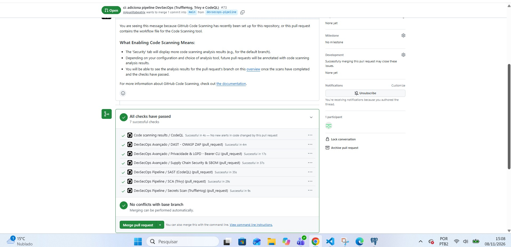

Fonte: captura de tela do GitHub (2026).

**Figura 2 – Execução da esteira na branch `main` (aba Actions), com os três jobs em verde**

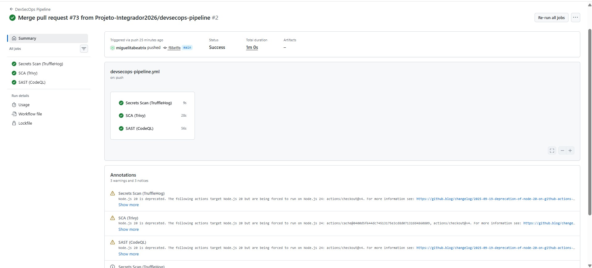

Fonte: captura de tela do GitHub (2026).

### 4.2 Política de bloqueio da branch principal

As Figuras 3 a 6 mostram o *ruleset* "protecao-main" ativo e as regras que o compõem, descritas na seção 2.4.

**Figura 3 – Ruleset "protecao-main" com status Active**

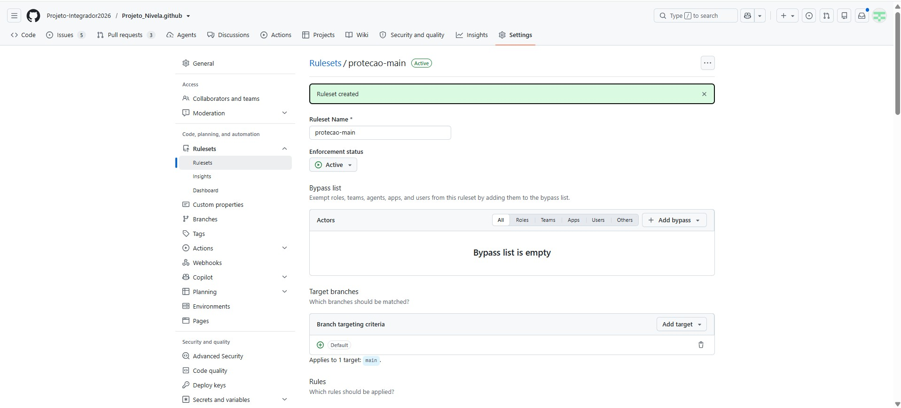

Fonte: captura de tela do GitHub (2026).

**Figura 4 – Regras do ruleset de proteção da main (parte 1)**

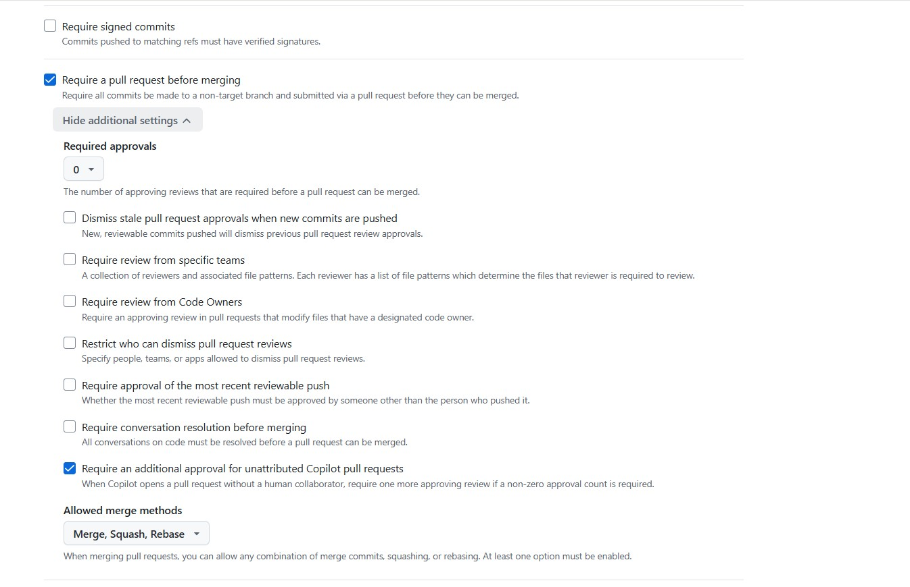

Fonte: captura de tela do GitHub (2026).

**Figura 5 – Regras do ruleset de proteção da main (parte 2)**

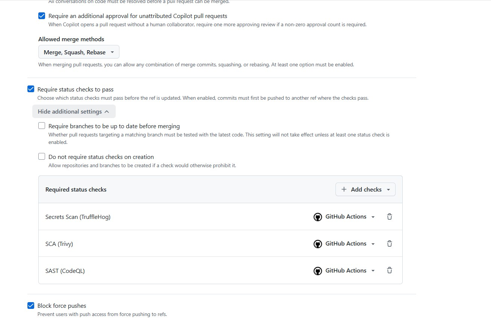

Fonte: captura de tela do GitHub (2026).

**Figura 6 – Regras do ruleset de proteção da main (parte 3)**

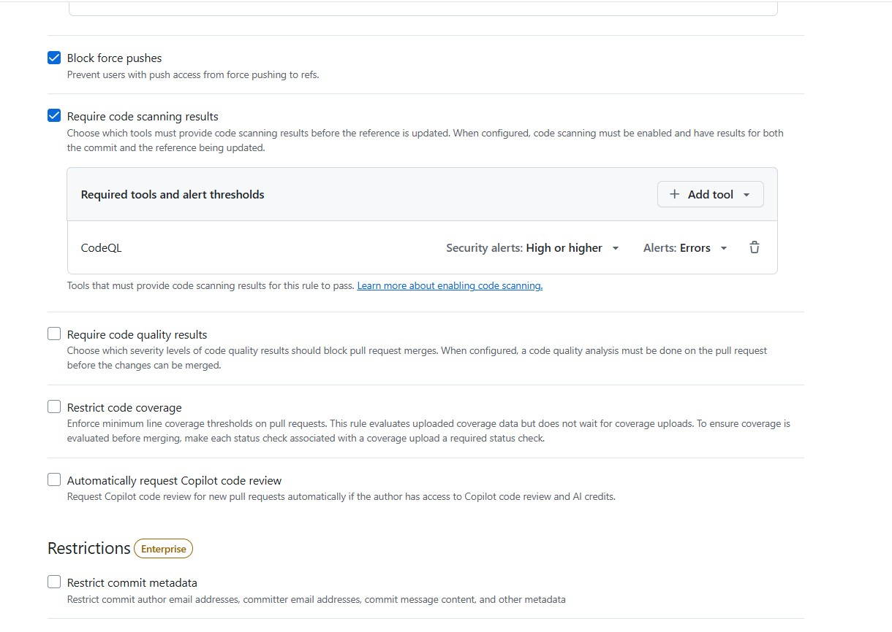

Fonte: captura de tela do GitHub (2026).

Enquanto os verificadores obrigatórios ainda estão em execução, o GitHub mantém o botão de *merge* bloqueado, o que comprova que a aprovação depende do resultado da esteira (Figura 7).

**Figura 7 – Merge bloqueado enquanto o CodeQL ainda não havia concluído**

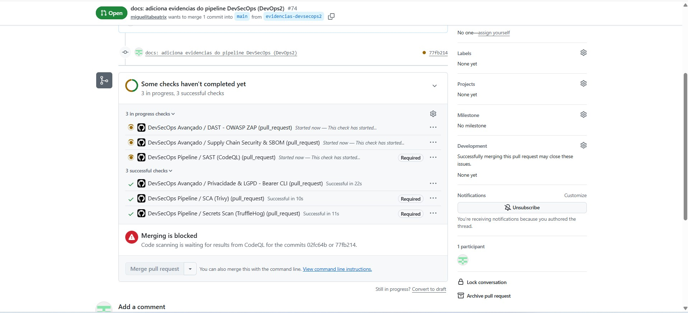

Fonte: captura de tela do GitHub (2026).

### 4.3 Teste de bloqueio do SCA (Trivy)

Para validar a política de bloqueio, foi criada uma branch descartável (`teste-bloqueio-trivy`) na qual se adicionou ao `requirements.txt` a biblioteca `requests==2.19.1`, versão sabidamente vulnerável. Foi aberto o *Pull Request* nº 75, que nunca foi integrado, apenas para observar o comportamento da esteira. Ao final, o PR foi fechado e a branch removida, de modo que a `main` permaneceu inalterada.

O job SCA (Trivy) falhou, enquanto os *jobs* de segredos e de SAST foram concluídos com sucesso. O registro do job (Figura 8) informa o resultado `Total: 1 (HIGH: 1, CRITICAL: 0)`, com a vulnerabilidade CVE-2018-18074 na biblioteca `requests` (versão instalada 2.19.1, versão corrigida 2.20.0), e termina com `Process completed with exit code 1`, o que comprova o funcionamento da política de falha do *build*.

**Figura 8 – Registro do job SCA (Trivy): detecção da CVE-2018-18074 e encerramento com exit code 1**

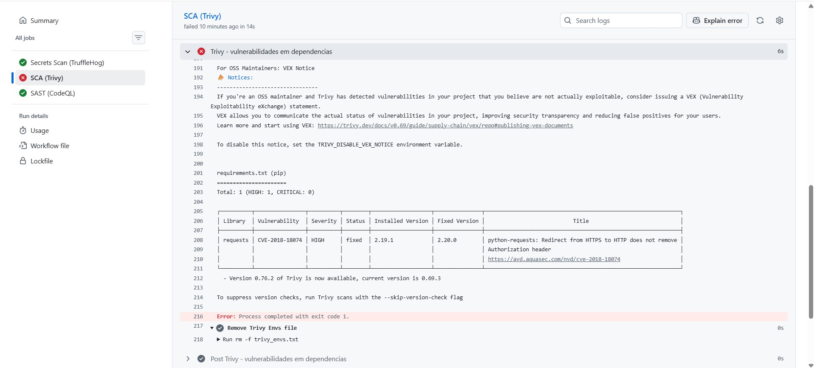

Fonte: captura de tela do GitHub (2026).

Como o SCA (Trivy) é um verificador obrigatório (*Required*), o GitHub bloqueou o *merge* do *Pull Request*, exibindo a mensagem "Merging is blocked due to failing merge requirements" (Figura 9).

**Figura 9 – Pull Request nº 75 com o SCA (Trivy) reprovado e o botão de merge bloqueado**

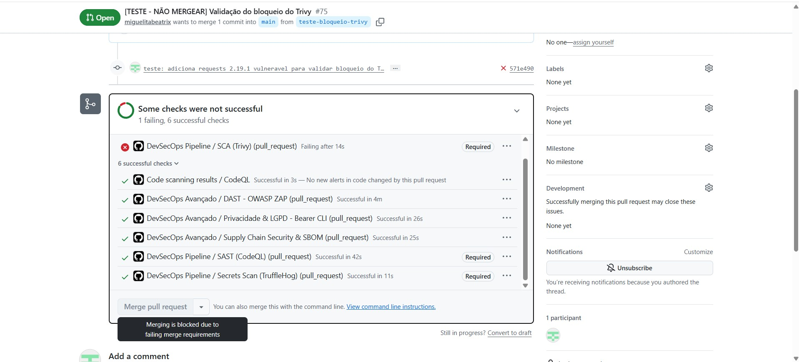

Fonte: captura de tela do GitHub (2026).

### 4.4 Mitigação dos alertas

Na data de elaboração deste relatório, o painel *Security > Code scanning* não apresenta alertas abertos do CodeQL na branch `main` (Figura 10). O único achado de segurança gerado pela esteira foi o do teste controlado descrito na seção 4.3.

**Figura 10 – Painel Code scanning sem alertas abertos na branch main**

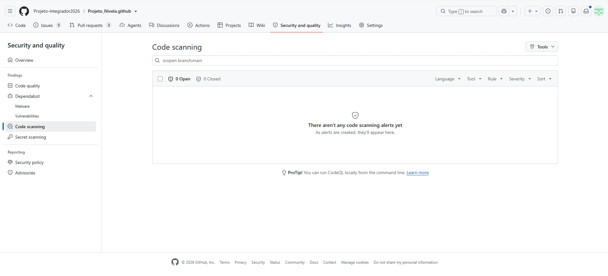

Fonte: captura de tela do GitHub (2026).

A mitigação dos achados de cada ferramenta segue o fluxo abaixo:

- **Vulnerabilidades em dependências (Trivy e Dependabot):** o Dependabot, configurado para verificar semanalmente os ecossistemas `pip` e `github-actions`, abriu automaticamente, já na primeira execução, nove Pull Requests de atualização (PRs nº 78 a 86), como a atualização do Django de 5.2.17 para 5.2.19 (PR nº 85) e da *action* do Trivy de 0.35.0 para 0.36.0 (PR nº 79), conforme a Figura 11. Cada PR passou pela mesma esteira, com todos os verificadores aprovados, antes de qualquer decisão de *merge*. A mitigação de uma vulnerabilidade apontada pelo Trivy consiste em atualizar a biblioteca para a versão informada na coluna *Fixed Version* (no exemplo, `requests` 2.20.0 ou superior), validar a aplicação e abrir um *Pull Request*.
- **Alertas do CodeQL (SAST):** analisar o trecho de código apontado (arquivo e linha) e corrigir a falha na origem, por exemplo com validação de entradas, consultas parametrizadas ou remoção de dados sensíveis dos *logs*. Se o alerta for um falso positivo, ele pode ser dispensado no painel com justificativa registrada, mantendo a rastreabilidade para auditoria.
- **Segredos expostos (TruffleHog):** revogar e substituir imediatamente a credencial, pois removê-la do código não a invalida no histórico do Git, e então registrar o incidente.

**Figura 11 – Pull Requests de atualização abertos automaticamente pelo Dependabot**

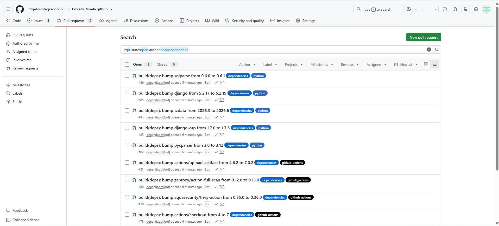

Fonte: captura de tela do GitHub (2026).

Em todos os casos, a correção só chega à `main` por *Pull Request* com os três verificadores aprovados, o que garante que a própria esteira valide a mitigação.

## 5 LIMITAÇÕES E MELHORIAS FUTURAS

- **TruffleHog com `--only-verified`:** o job reprova apenas segredos confirmados como ativos. Credenciais inativas, de formato desconhecido ou não verificáveis podem passar. Se necessário, a opção pode ser removida, aceitando mais falsos positivos.
- **Trivy sem falhas não corrigidas:** a configuração ignora vulnerabilidades para as quais ainda não existe versão corrigida, pois não há ação possível além de monitorar. Elas deixam de bloquear o *build*, mas continuam existindo.
- **Bloqueio do CodeQL indireto:** o job não falha sozinho; o bloqueio depende da regra de *code scanning* do *ruleset*, e o GitHub pode demorar alguns instantes para atualizá-la no PR.
- **SAST e SCA têm alcance limitado:** a análise estática não encontra falhas que só aparecem em execução, e o SCA depende da base pública de vulnerabilidades. Testes dinâmicos, como os da atividade anterior do projeto, complementam essa cobertura.
- **Cadeia de suprimentos da própria esteira:** a *action* do Trivy foi fixada em uma versão específica (0.35.0), prática que reduz o risco de alterações indevidas em *actions* de terceiros. Recomenda-se revisar também as demais *actions* e os fluxos de trabalho anteriores, bem como atualizar as versões que exibem o aviso de descontinuação do Node.js 20.
- **Atualizações pendentes do Dependabot:** os Pull Requests abertos pelo Dependabot não foram integrados durante a atividade, para evitar regressões na aplicação às vésperas da entrega. Eles, inclusive o que atualiza a *action* do Trivy, serão avaliados e testados em ciclo próprio.
- **Proteção da própria esteira:** como o repositório é público, recomenda-se manter permissões mínimas no workflow e revisar periodicamente as regras de proteção.

## 6 CONSIDERAÇÕES FINAIS

A esteira implementada atende ao que a atividade propôs: três verificações de segurança automatizadas e complementares (segredos, dependências e código) rodando no GitHub Actions, com bloqueio do *build* diante de achados graves e com a branch principal protegida por regras que tornam essas verificações obrigatórias. O teste controlado com a biblioteca `requests` 2.19.1 demonstrou, de ponta a ponta, que a vulnerabilidade foi detectada, o job foi reprovado com `exit code 1` e o *merge* foi impedido.

Para o Projeto Nivela, o principal benefício é a proteção contínua dos requisitos de autenticação, criptografia, auditoria e proteção de dados pessoais, junto com a geração de evidências rastreáveis para a avaliação. As limitações foram identificadas e documentadas, e a evolução natural da esteira inclui a avaliação e a integração gradual das atualizações propostas pelo Dependabot, o refinamento das regras de severidade e a ampliação da cobertura com testes dinâmicos.

## REFERÊNCIAS

AQUA SECURITY. **Trivy**: documentação oficial. [S. l.]: Aqua Security, 2026. Disponível em: https://github.com/aquasecurity/trivy. Acesso em: 8 nov. 2026.

BRASIL. **Lei nº 13.709, de 14 de agosto de 2018**. Lei Geral de Proteção de Dados Pessoais (LGPD). Diário Oficial da União: seção 1, Brasília, DF, 15 ago. 2018.

GITHUB. **CodeQL**: documentação oficial sobre code scanning. [S. l.]: GitHub, 2026a. Disponível em: https://codeql.github.com/docs/. Acesso em: 8 nov. 2026.

GITHUB. **GitHub Docs**: Actions, rulesets e proteção de branches. [S. l.]: GitHub, 2026b. Disponível em: https://docs.github.com. Acesso em: 8 nov. 2026.

OWASP. **OWASP Top 10:2021**. [S. l.]: OWASP Foundation, 2021. Disponível em: https://owasp.org/Top10/. Acesso em: 8 nov. 2026.

TRUFFLE SECURITY. **TruffleHog**: documentação oficial. [S. l.]: Truffle Security, 2026. Disponível em: https://github.com/trufflesecurity/trufflehog. Acesso em: 8 nov. 2026.

Fonte: elaborado pelos autores (2026), com base no documento "Requisitos 1".

Do ponto de vista de **auditoria**, a esteira oferece três evidências permanentes: o histórico das execuções na aba *Actions*, o painel de alertas em *Security > Code scanning* e o registro dos *Pull Requests*, que mostra quais verificações foram aprovadas antes de cada *merge*. Do ponto de vista de **conformidade**, a combinação entre esteira e proteção da branch transforma a segurança em regra obrigatória do processo, e não em boa intenção. Ressalta-se, porém, que essas verificações sustentam a conformidade, mas não a garantem sozinhas: a análise automatizada não substitui a revisão técnica e jurídica do atendimento à LGPD.

## 4 EVIDÊNCIAS DE FUNCIONAMENTO

Esta seção reúne as evidências de que a esteira (`.github/workflows/devsecops-pipeline.yml`) executa os três *jobs* solicitados, de que a branch `main` está protegida e de que a política de bloqueio impede o *merge* de código com vulnerabilidades de severidade alta ou crítica.

### 4.1 Execução bem-sucedida da esteira

A esteira foi introduzida pelo *Pull Request* nº 73. Os três *jobs* (*Secrets Scan* com TruffleHog, SCA com Trivy e SAST com CodeQL) foram concluídos com sucesso tanto no evento `pull_request` quanto, após o *merge*, no evento `push` na `main`, como mostram as Figuras 1 e 2.

**Figura 1 – Pull Request nº 73 com os três verificadores obrigatórios aprovados**

Fonte: captura de tela do GitHub (2026).

**Figura 2 – Execução da esteira na branch `main` (aba Actions), com os três jobs em verde**

Fonte: captura de tela do GitHub (2026).

### 4.2 Política de bloqueio da branch principal

As Figuras 3 a 6 mostram o *ruleset* "protecao-main" ativo e as regras que o compõem, descritas na seção 2.4.

**Figura 3 – Ruleset "protecao-main" com status Active**

Fonte: captura de tela do GitHub (2026).

**Figura 4 – Regras do ruleset de proteção da main (parte 1)**

Fonte: captura de tela do GitHub (2026).

**Figura 5 – Regras do ruleset de proteção da main (parte 2)**

Fonte: captura de tela do GitHub (2026).

**Figura 6 – Regras do ruleset de proteção da main (parte 3)**

Fonte: captura de tela do GitHub (2026).

Enquanto os verificadores obrigatórios ainda estão em execução, o GitHub mantém o botão de *merge* bloqueado, o que comprova que a aprovação depende do resultado da esteira (Figura 7).

**Figura 7 – Merge bloqueado enquanto o CodeQL ainda não havia concluído**

Fonte: captura de tela do GitHub (2026).

### 4.3 Teste de bloqueio do SCA (Trivy)

Para validar a política de bloqueio, foi criada uma branch descartável (`teste-bloqueio-trivy`) na qual se adicionou ao `requirements.txt` a biblioteca `requests==2.19.1`, versão sabidamente vulnerável. Foi aberto o *Pull Request* nº 75, que nunca foi integrado, apenas para observar o comportamento da esteira. Ao final, o PR foi fechado e a branch removida, de modo que a `main` permaneceu inalterada.

O job SCA (Trivy) falhou, enquanto os *jobs* de segredos e de SAST foram concluídos com sucesso. O registro do job (Figura 8) informa o resultado `Total: 1 (HIGH: 1, CRITICAL: 0)`, com a vulnerabilidade CVE-2018-18074 na biblioteca `requests` (versão instalada 2.19.1, versão corrigida 2.20.0), e termina com `Process completed with exit code 1`, o que comprova o funcionamento da política de falha do *build*.

**Figura 8 – Registro do job SCA (Trivy): detecção da CVE-2018-18074 e encerramento com exit code 1**

Fonte: captura de tela do GitHub (2026).

Como o SCA (Trivy) é um verificador obrigatório (*Required*), o GitHub bloqueou o *merge* do *Pull Request*, exibindo a mensagem "Merging is blocked due to failing merge requirements" (Figura 9).

**Figura 9 – Pull Request nº 75 com o SCA (Trivy) reprovado e o botão de merge bloqueado**

Fonte: captura de tela do GitHub (2026).

### 4.4 Mitigação dos alertas

Na data de elaboração deste relatório, o painel *Security > Code scanning* não apresenta alertas abertos do CodeQL na branch `main` (Figura 10). O único achado de segurança gerado pela esteira foi o do teste controlado descrito na seção 4.3.

**Figura 10 – Painel Code scanning sem alertas abertos na branch main**

Fonte: captura de tela do GitHub (2026).

A mitigação dos achados de cada ferramenta segue o fluxo abaixo:

- **Vulnerabilidades em dependências (Trivy e Dependabot):** o Dependabot, configurado para verificar semanalmente os ecossistemas `pip` e `github-actions`, abriu automaticamente, já na primeira execução, nove Pull Requests de atualização (PRs nº 78 a 86), como a atualização do Django de 5.2.17 para 5.2.19 (PR nº 85) e da *action* do Trivy de 0.35.0 para 0.36.0 (PR nº 79), conforme a Figura 11. Cada PR passou pela mesma esteira, com todos os verificadores aprovados, antes de qualquer decisão de *merge*. A mitigação de uma vulnerabilidade apontada pelo Trivy consiste em atualizar a biblioteca para a versão informada na coluna *Fixed Version* (no exemplo, `requests` 2.20.0 ou superior), validar a aplicação e abrir um *Pull Request*.
- **Alertas do CodeQL (SAST):** analisar o trecho de código apontado (arquivo e linha) e corrigir a falha na origem, por exemplo com validação de entradas, consultas parametrizadas ou remoção de dados sensíveis dos *logs*. Se o alerta for um falso positivo, ele pode ser dispensado no painel com justificativa registrada, mantendo a rastreabilidade para auditoria.
- **Segredos expostos (TruffleHog):** revogar e substituir imediatamente a credencial, pois removê-la do código não a invalida no histórico do Git, e então registrar o incidente.

**Figura 11 – Pull Requests de atualização abertos automaticamente pelo Dependabot**

Fonte: captura de tela do GitHub (2026).

Em todos os casos, a correção só chega à `main` por *Pull Request* com os três verificadores aprovados, o que garante que a própria esteira valide a mitigação.

## 5 LIMITAÇÕES E MELHORIAS FUTURAS

- **TruffleHog com `--only-verified`:** o job reprova apenas segredos confirmados como ativos. Credenciais inativas, de formato desconhecido ou não verificáveis podem passar. Se necessário, a opção pode ser removida, aceitando mais falsos positivos.
- **Trivy sem falhas não corrigidas:** a configuração ignora vulnerabilidades para as quais ainda não existe versão corrigida, pois não há ação possível além de monitorar. Elas deixam de bloquear o *build*, mas continuam existindo.
- **Bloqueio do CodeQL indireto:** o job não falha sozinho; o bloqueio depende da regra de *code scanning* do *ruleset*, e o GitHub pode demorar alguns instantes para atualizá-la no PR.
- **SAST e SCA têm alcance limitado:** a análise estática não encontra falhas que só aparecem em execução, e o SCA depende da base pública de vulnerabilidades. Testes dinâmicos, como os da atividade anterior do projeto, complementam essa cobertura.
- **Cadeia de suprimentos da própria esteira:** a *action* do Trivy foi fixada em uma versão específica (0.35.0), prática que reduz o risco de alterações indevidas em *actions* de terceiros. Recomenda-se revisar também as demais *actions* e os fluxos de trabalho anteriores, bem como atualizar as versões que exibem o aviso de descontinuação do Node.js 20.
- **Atualizações pendentes do Dependabot:** os Pull Requests abertos pelo Dependabot não foram integrados durante a atividade, para evitar regressões na aplicação às vésperas da entrega. Eles, inclusive o que atualiza a *action* do Trivy, serão avaliados e testados em ciclo próprio.
- **Proteção da própria esteira:** como o repositório é público, recomenda-se manter permissões mínimas no workflow e revisar periodicamente as regras de proteção.

## 6 CONSIDERAÇÕES FINAIS

A esteira implementada atende ao que a atividade propôs: três verificações de segurança automatizadas e complementares (segredos, dependências e código) rodando no GitHub Actions, com bloqueio do *build* diante de achados graves e com a branch principal protegida por regras que tornam essas verificações obrigatórias. O teste controlado com a biblioteca `requests` 2.19.1 demonstrou, de ponta a ponta, que a vulnerabilidade foi detectada, o job foi reprovado com `exit code 1` e o *merge* foi impedido.

Para o Projeto Nivela, o principal benefício é a proteção contínua dos requisitos de autenticação, criptografia, auditoria e proteção de dados pessoais, junto com a geração de evidências rastreáveis para a avaliação. As limitações foram identificadas e documentadas, e a evolução natural da esteira inclui a avaliação e a integração gradual das atualizações propostas pelo Dependabot, o refinamento das regras de severidade e a ampliação da cobertura com testes dinâmicos.

## REFERÊNCIAS

AQUA SECURITY. **Trivy**: documentação oficial. [S. l.]: Aqua Security, 2026. Disponível em: https://github.com/aquasecurity/trivy. Acesso em: 8 nov. 2026.

BRASIL. **Lei nº 13.709, de 14 de agosto de 2018**. Lei Geral de Proteção de Dados Pessoais (LGPD). Diário Oficial da União: seção 1, Brasília, DF, 15 ago. 2018.

GITHUB. **CodeQL**: documentação oficial sobre code scanning. [S. l.]: GitHub, 2026a. Disponível em: https://codeql.github.com/docs/. Acesso em: 8 nov. 2026.

GITHUB. **GitHub Docs**: Actions, rulesets e proteção de branches. [S. l.]: GitHub, 2026b. Disponível em: https://docs.github.com. Acesso em: 8 nov. 2026.

OWASP. **OWASP Top 10:2021**. [S. l.]: OWASP Foundation, 2021. Disponível em: https://owasp.org/Top10/. Acesso em: 8 nov. 2026.

TRUFFLE SECURITY. **TruffleHog**: documentação oficial. [S. l.]: Truffle Security, 2026. Disponível em: https://github.com/trufflesecurity/trufflehog. Acesso em: 8 nov. 2026.
