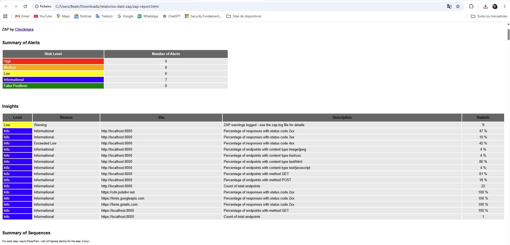

# Testes Dinâmicos de Segurança (DAST) com OWASP ZAP

## 1. Visão Geral
Como parte da esteira DevSecOps do Projeto Nivela, foi implementada a análise dinâmica de segurança (DAST) automatizada via GitHub Actions. O scanner OWASP ZAP realiza varreduras ativas e passivas na aplicação em execução para identificar potenciais vulnerabilidades.

## 2. Resultado da Varredura
A execução automatizada do pipeline obteve aprovação no *Quality Gate*, não identificando vulnerabilidades críticas.

### Resumo dos Alertas:
* **Crítico / Alto (High):** 0
* **Médio (Medium):** 6
* **Baixo (Low):** 6
* **Informativo (Info):** 7
* **Endpoints Analisados:** 22

## 3. Evidência de Execução

*Figura 1: Relatório de varredura dinâmica gerado pelo OWASP ZAP.*

## 4. Análise Técnica e Próximos Passos
Os alertas de nível médio identificados referem-se maioritariamente à ausência de cabeçalhos de segurança HTTP (como *Content Security Policy - CSP*). Estas melhorias foram documentadas para implementação nas próximas iterações.