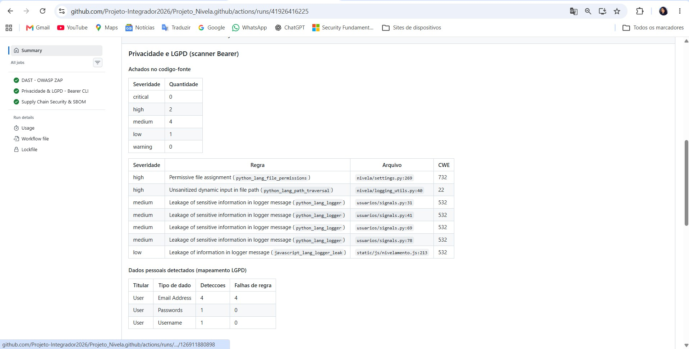

# Auditoria de Privacidade de Dados e LGPD com Bearer CLI

## 1. Visão Geral
Como parte da esteira DevSecOps do Projeto Nivela, o scanner estático **Bearer CLI** analisa o código-fonte a cada push e a cada Pull Request para a `main`. O objetivo é encontrar falhas lógicas ligadas à privacidade, como vazamento de dados pessoais (PII) em logs, e mapear quais dados pessoais o código manipula. O resultado apoia a auditoria de conformidade com a LGPD, mas não a substitui.

O job se chama **Privacidade & LGPD - Bearer CLI** e está definido em `.github/workflows/devsecops-avancado.yml`.

## 2. Como a esteira funciona
Dois relatórios são gerados em cada execução:

| Relatório | Comando | Papel na esteira |
|---|---|---|
| Segurança (`bearer-report.json`) | `bearer scan . --report security --fail-on-severity critical` | **Quality gate:** o build falha se houver achado de severidade crítica. |
| Privacidade (`bearer-privacy.json`) | `bearer scan . --report privacy` | Evidência de mapeamento de dados pessoais. Não bloqueia o build. |

Um passo adicional verifica que os dois arquivos foram realmente gerados. Se faltar algum, o job falha, o que evita um job verde sem varredura. Os dois relatórios ficam disponíveis como artefato **relatorio-privacidade-bearer** na aba Actions, e um resumo é escrito na aba Summary da execução.

## 3. Resultado da varredura

| Severidade | Quantidade |
|---|---|
| Crítica | 0 |
| Alta | 2 |
| Média | 4 |
| Baixa | 1 |

Não há achados críticos, portanto o quality gate foi aprovado. Os achados de severidade alta, média e baixa não bloqueiam o build; por isso foram analisados manualmente (seção 4).

**Dados pessoais mapeados no código:** e-mail (4 detecções), senha (1) e nome de usuário (1).

*Figura 1: Resumo do Bearer CLI na aba Summary da execução do workflow.*

## 4. Análise dos achados

| Severidade | Regra | Arquivo | Avaliação |
|---|---|---|---|
| Alta | `python_lang_file_permissions` | `nivela/settings.py:269` | **Falso positivo.** A linha aplica `os.chmod(logs, 0o700)`, que restringe a pasta de logs ao dono (item 5.3). É uma proteção, não uma permissão excessiva. |
| Alta | `python_lang_path_traversal` | `nivela/logging_utils.py:40` | **Falso positivo.** O caminho aberto vem da configuração do handler em `settings.py`, não de entrada do usuário. |
| Média (4) | `python_lang_logger` | `usuarios/signals.py:31, 41, 69, 78` | **Mitigado.** O e-mail passa por `mascarar_email()` antes de ir para o log (ex.: `b***@gmail.com`); o scanner não reconhece essa função como sanitização. O IP é gravado sem máscara, por necessidade de auditoria (itens 5.1 e 5.2). |
| Baixa | `javascript_lang_logger_leak` | `static/js/nivelamento.js:213` | **Risco baixo.** `console.error` exibe apenas o erro de uma requisição no console do navegador, sem dado pessoal. |

**Sobre o IP nos logs:** o endereço IP é dado pessoal. Ele é registrado para detectar tentativas de acesso indevido, com base legal de legítimo interesse (art. 7º, IX da LGPD), conforme o inventário de dados (`lgpd-inventario-dados.md`). A estrutura dos logs está descrita em `auditoria-logs.md`.

## 5. Limitações
- O quality gate bloqueia somente achados **críticos**. Achados de severidade alta exigem revisão manual, como feito na seção 4.
- O Bearer faz análise estática e não reconhece funções próprias de mascaramento, o que explica os 4 achados médios.
- A ferramenta não substitui a revisão jurídica da conformidade com a LGPD.