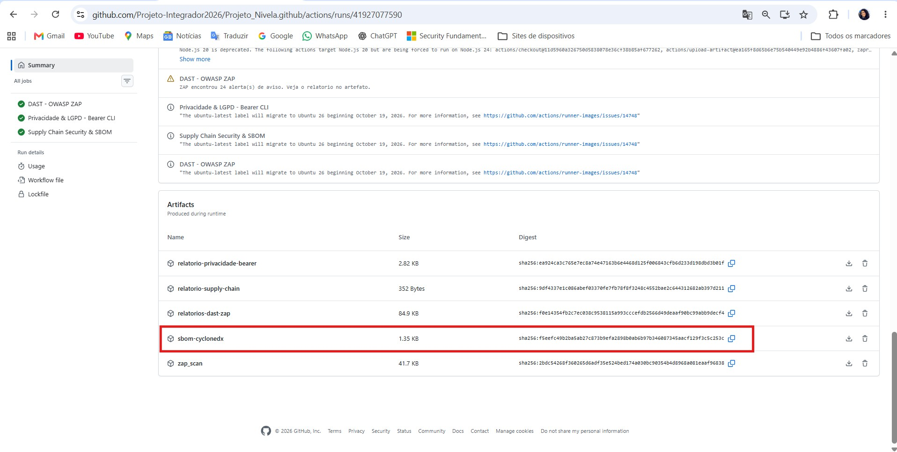

# Segurança da Cadeia de Suprimentos (Supply Chain Security) e SBOM

## 1. Visão Geral
Como parte da esteira DevSecOps do Projeto Nivela, o job **Supply Chain Security & SBOM** (em `.github/workflows/devsecops-avancado.yml`) audita as dependências do projeto e gera um **SBOM (Software Bill of Materials)**: a lista de todos os componentes de terceiros e suas versões. Ele roda a cada push e a cada Pull Request para a `main`.

## 2. Ferramentas e etapas

| Etapa | Ferramenta | Resultado |
|---|---|---|
| Auditoria de dependências Python | `pip-audit -r requirements.txt` | Consulta bases públicas de vulnerabilidades (CVEs) para os pacotes do `requirements.txt`. Informativa: não bloqueia o build. |
| Varredura do repositório | Trivy (`fs`) | Relatório em tabela, publicado como artefato `relatorio-supply-chain` (`trivy-report.txt`). |
| Geração do SBOM | Trivy (formato CycloneDX) | Arquivo `sbom-cyclonedx.json`, publicado como artefato `sbom-cyclonedx`. |

## 3. SBOM (CycloneDX)
O SBOM é gerado no formato padrão **CycloneDX**, em JSON, e lista cada dependência do `requirements.txt` com sua versão fixada (por exemplo, Django 5.2.17 e cryptography 50.0.1). Para baixá-lo, abra a execução do workflow na aba **Actions** do GitHub, role até a seção **Artifacts** e baixe `sbom-cyclonedx`.

*Figura 1: Seção Artifacts da execução do workflow, com o artefato `sbom-cyclonedx` disponível para download.*

## 4. Proteção da própria esteira
A esteira também é parte da cadeia de suprimentos. Por isso:
- As actions de terceiros são fixadas pelo **SHA do commit**, e não por tag. Tags podem ser redirecionadas; foi o que aconteceu com a `trivy-action` em março de 2026 (CVE-2026-33634), quando dezenas de tags foram apontadas para código malicioso. Com o SHA fixo, a esteira só executa o código que foi revisado.
- O workflow declara `permissions: contents: read`, o mínimo necessário para ler o repositório.
- As chaves usadas no teste dinâmico (DAST) são geradas a cada execução e mascaradas nos logs.

## 5. Limitações
- O SBOM é gerado a partir do repositório (`requirements.txt`), e não da imagem Docker final.
- A auditoria de vulnerabilidades (`pip-audit` e Trivy) é informativa. O bloqueio do build, conforme a atividade, fica a cargo do OWASP ZAP e do Bearer.