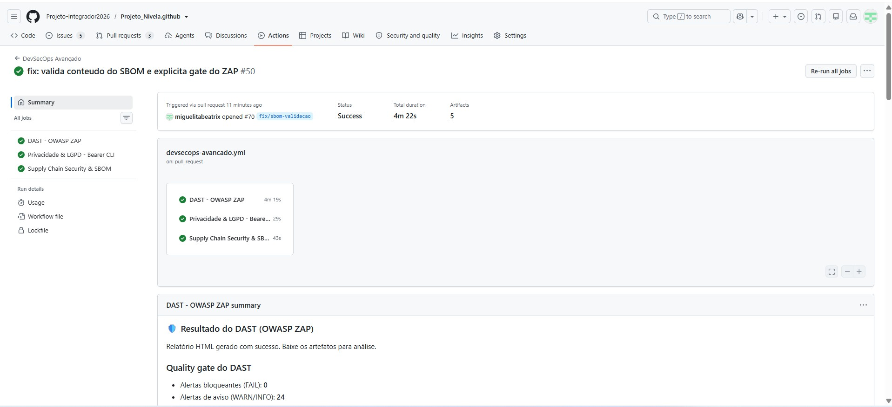
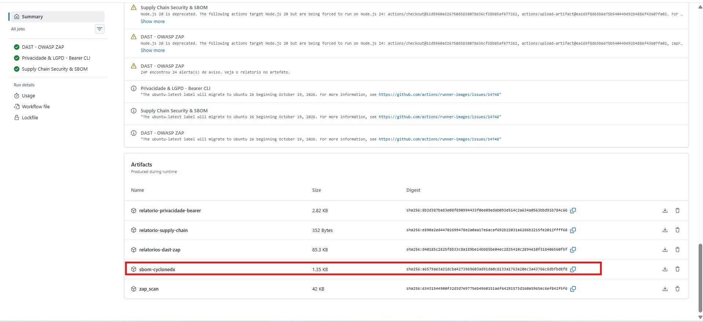
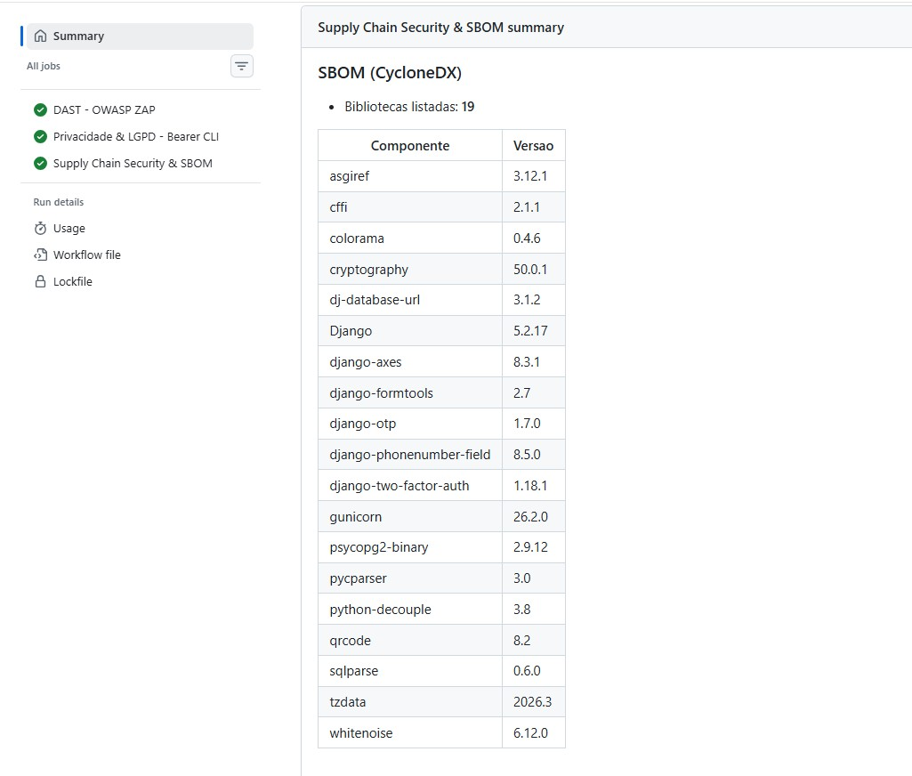
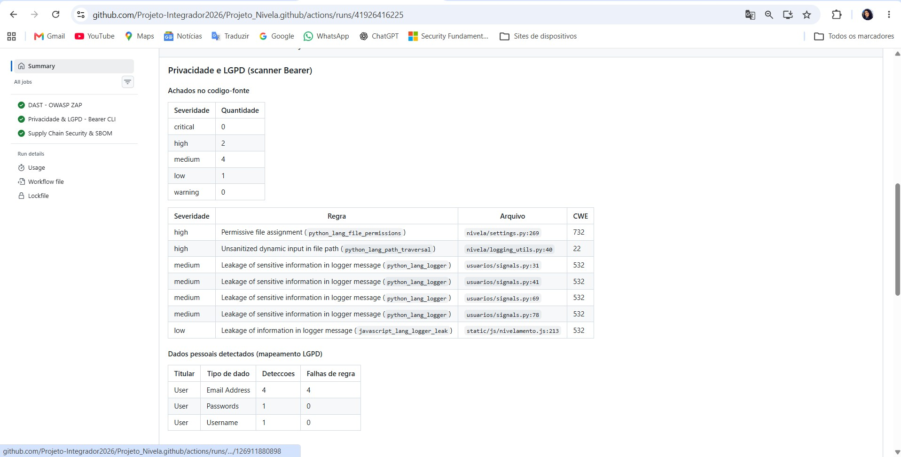
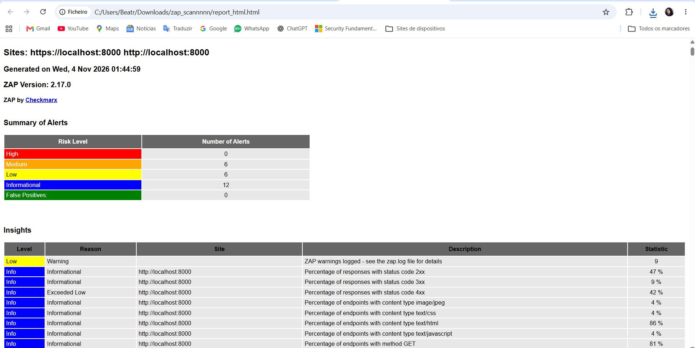
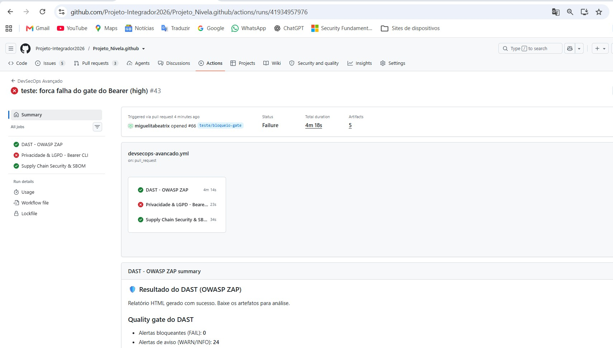
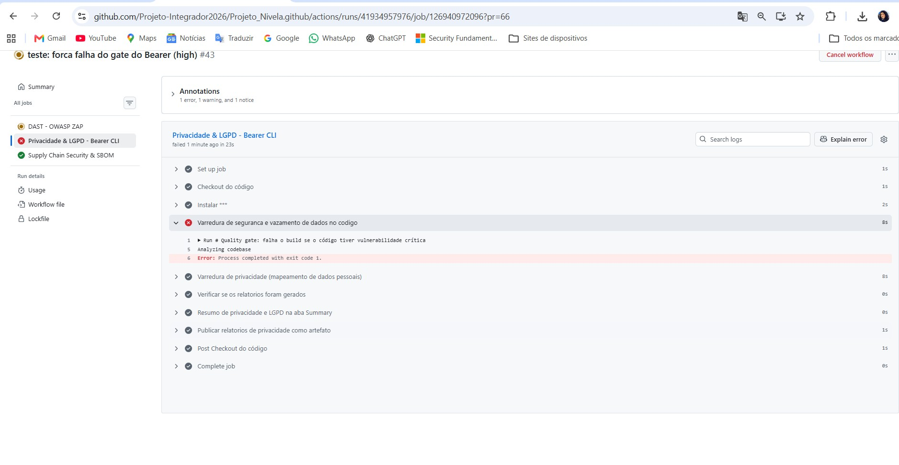

# Relatório Técnico

## DevSecOps Avançado com ferramentas open-source: DAST, privacidade (LGPD) e cadeia de suprimentos (SBOM)

**Projeto Nivela - Projeto Integrador 2026**

| | |
|---|---|
| **Repositório** | github.com/Projeto-Integrador2026/Projeto_Nivela.github |
| **Workflow** | `.github/workflows/devsecops-avancado.yml` (GitHub Actions) |
| **Ferramentas** | OWASP ZAP 2.17.0 (DAST), Bearer CLI (privacidade), Trivy (SBOM CycloneDX) |
| **Responsável pela documentação** | Beatriz Miguel |
| **Data** | 04/11/2026 |

---

## Resumo

Este relatório descreve as três verificações de segurança adicionadas à esteira de CI do Projeto Nivela, uma plataforma web em Django: teste dinâmico da aplicação em execução (OWASP ZAP), auditoria de privacidade e dados pessoais no código (Bearer) e inventário de dependências em formato SBOM (Trivy). Todas rodam automaticamente a cada push e a cada Pull Request para a `main`, usando apenas ferramentas gratuitas e o GitHub Actions.

| Verificação | Resultado na última execução | Bloqueia o build? |
|---|---|---|
| DAST - OWASP ZAP | 0 alertas bloqueantes; 24 avisos (6 médios, 6 baixos, 12 informativos) | Sim, se houver alerta `FAIL` |
| Privacidade - Bearer | 0 críticos; 2 altos (falsos positivos), 4 médios, 1 baixo; 3 tipos de dado pessoal mapeados | Sim, se houver achado crítico |
| Supply chain - Trivy | SBOM CycloneDX com 19 bibliotecas, gerado, validado e publicado como artefato `sbom-cyclonedx` | Não (informativo); o job falha apenas se o SBOM sair vazio |

O funcionamento do bloqueio foi comprovado em um Pull Request de teste (PR #66), em que o job do Bearer foi reprovado com exit code 1 (seção 5.4).

---

## 1. Introdução à arquitetura open-source

DevSecOps consiste em levar as verificações de segurança para dentro da esteira de entrega, de modo que cada alteração de código seja analisada antes de chegar à branch principal. Um nível profissional não depende de licenças pagas: depende de automação, de critérios objetivos de aprovação e de evidências rastreáveis. Todas essas práticas podem ser obtidas com ferramentas comunitárias e gratuitas, executadas nos runners hospedados do GitHub Actions.

A arquitetura adotada combina três ferramentas que se complementam, cada uma olhando para uma camada diferente do software:

| Camada | Pergunta que responde | Ferramenta |
|---|---|---|
| Aplicação em execução | Um atacante externo consegue explorar a aplicação rodando? | OWASP ZAP (DAST) |
| Código-fonte e dados pessoais | O código trata ou vaza dados pessoais de forma indevida? | Bearer CLI |
| Componentes de terceiros | Quais bibliotecas e versões compõem o software entregue? | Trivy (SBOM CycloneDX) |

Quatro princípios orientaram a implementação:

- **Pipeline como código:** toda a esteira está versionada em um único arquivo YAML, revisado por Pull Request como qualquer outro código.
- **Falhar cedo:** achados graves reprovam o job e impedem o avanço do código, com critérios definidos de forma explícita.
- **Evidência como artefato:** cada execução publica relatórios e o SBOM na aba Actions, associados ao commit analisado.
- **Proteção da própria esteira:** permissões mínimas (`contents: read`), ações do GitHub Actions fixadas por SHA de commit (a instalação do Bearer CLI e do pip-audit ainda usa a versão mais recente, o que consta como melhoria futura) e segredos de teste gerados a cada execução e mascarados nos logs.

---

## 2. Descritivo técnico das ferramentas

A esteira possui três jobs independentes, definidos em `devsecops-avancado.yml`:

| Job | Ferramenta | O que analisa | Critério de falha | Artefatos |
|---|---|---|---|---|
| DAST - OWASP ZAP | OWASP ZAP | Aplicação em execução (`localhost:8000`) | Alerta com ação `FAIL` em `.zap/rules.tsv` | `relatorios-dast-zap`, `zap_scan` |
| Privacidade & LGPD - Bearer CLI | Bearer CLI | Código-fonte | Severidade crítica (`--fail-on-severity critical`) | `relatorio-privacidade-bearer` |
| Supply Chain Security & SBOM | Trivy e pip-audit | Dependências do `requirements.txt` | Informativo; falha apenas se o SBOM sair vazio | `sbom-cyclonedx`, `relatorio-supply-chain` |

### 2.1 OWASP ZAP - testes em execução (DAST)

O ZAP atua como um atacante externo: sem acesso ao código, ele envia requisições à aplicação em funcionamento e analisa as respostas. Isso encontra problemas que só aparecem em execução, como XSS, injeções e cabeçalhos de segurança ausentes. No job, a esteira executa estes passos:

- faz o build da imagem Docker da aplicação e sobe um PostgreSQL de teste;
- inicia a aplicação com `DEBUG=False` no runner, acessível em `localhost:8000`, com segredos gerados na hora e mascarados nos logs;
- executa o ZAP contra a aplicação e gera o relatório HTML, publicado como artefato;
- aplica o quality gate: o resultado é comparado com as regras de `.zap/rules.tsv`.

O arquivo `.zap/rules.tsv` define, por ID de regra, o que reprova o build. Regras ausentes do arquivo ficam como aviso:

| Categoria | Regras (ID do ZAP) | Ação |
|---|---|---|
| Cross Site Scripting | 40012 (refletido), 40014 (persistente), 40026 (DOM) | FAIL |
| SQL Injection | 40018 (genérica), 40019 (MySQL), 40020 (Hypersonic SQL), 40021 (Oracle), 40022 (PostgreSQL), 40024 (SQLite) | FAIL |
| Injeções no servidor | 90019 (Server Side Code Injection), 90020 (Remote OS Command Injection), 40003 (CRLF Injection) | FAIL |
| Acesso a arquivos | 6 (Path Traversal), 7 (Remote File Inclusion) | FAIL |
| HSTS | 10035 (Strict-Transport-Security não definido) | IGNORE |
| Demais regras (ex.: CSP ausente) | Não listadas no arquivo | WARN |

A regra de HSTS é ignorada de propósito: no CI a aplicação roda em HTTP puro, sem TLS, e o cabeçalho só é emitido em HTTPS. Em produção ele é verificado. Resultado: **0 alertas bloqueantes e 24 avisos** (6 médios, 6 baixos e 12 informativos), sendo os médios majoritariamente cabeçalhos de segurança HTTP ausentes, como a Content-Security-Policy.

### 2.2 Bearer - privacidade e dados sensíveis

O Bearer é um analisador estático de código voltado a privacidade. Ele identifica quais tipos de dado pessoal o código manipula (por exemplo, e-mail, senha e nome de usuário) e verifica se esses dados chegam a pontos de risco, como mensagens de log, arquivos ou chamadas externas. Isso conecta o código ao inventário de dados exigido pela LGPD. O job gera dois relatórios:

| Relatório | Comando | Papel |
|---|---|---|
| Segurança (`bearer-report.json`) | `bearer scan . --report security --fail-on-severity critical` | Quality gate: falha o job com achado crítico |
| Privacidade (`bearer-privacy.json`) | `bearer scan . --report privacy` | Mapeamento de dados pessoais (não bloqueia) |

Um passo adicional confere se os dois arquivos foram realmente gerados, evitando um job verde sem varredura. No Bearer, a flag `--fail-on-severity` é o mecanismo que encerra o scan com código de saída 1 (exit code 1) quando há achado na severidade configurada. Resultado: 0 críticos, 2 altos, 4 médios e 1 baixo, todos triados manualmente:

| Severidade | Regra / local | Conclusão da triagem |
|---|---|---|
| Alta (2) | `file_permissions` (`settings.py:269`) e `path_traversal` (`logging_utils.py:40`) | Falsos positivos: o `chmod 0o700` é restritivo e o caminho vem da configuração do handler de log, não do usuário. |
| Média (4) | `python_lang_logger` (`usuarios/signals.py`) | Mitigado: o e-mail é mascarado por `mascarar_email()` antes do log; o IP é mantido por segurança (legítimo interesse). |
| Baixa (1) | `javascript_lang_logger_leak` (`nivelamento.js:213`) | Risco baixo: `console.error` sem dado pessoal. |

### 2.3 Trivy - inventário e SBOM

O Trivy é um scanner de segurança que também gera SBOM. Um SBOM (Software Bill of Materials) é a lista de todos os componentes de terceiros embutidos no software, com suas versões. O job usa o Trivy para ler o `requirements.txt` e gerar o arquivo `sbom-cyclonedx.json` no padrão CycloneDX, um formato aberto e amplamente aceito por ferramentas de auditoria. O arquivo é publicado como artefato baixável na aba Actions.

O mesmo job também produz o relatório de vulnerabilidades (artefato `relatorio-supply-chain`) e audita as dependências Python com `pip-audit -r requirements.txt`. Ambas as auditorias são informativas; o objetivo central do job é entregar o inventário.

O job também **valida o SBOM gerado**: um passo em Python confere se o arquivo é CycloneDX válido e se contém ao menos uma biblioteca; caso contrário, o job falha. A lista de componentes e versões é escrita na aba Summary da execução (Figura 3), o que comprova que o inventário não está vazio: na última execução, o SBOM listou **19 bibliotecas**. O `requirements.txt` foi normalizado (UTF-8 sem BOM e finais de linha LF) para garantir a leitura correta pelo Trivy.

---

## 3. Integração com os requisitos do projeto

### 3.1 SBOM e confiança na entrega

O SBOM transforma a pergunta "que código de terceiros está dentro do software?" em um arquivo verificável. Para clientes e stakeholders, isso traz três ganhos:

- **Transparência:** a lista completa de componentes e versões.
- **Rastreabilidade:** cada execução gera um SBOM ligado ao commit analisado, com hash SHA-256 visível na aba Actions.
- **Resposta rápida a incidentes:** quando uma biblioteca é apontada como vulnerável, basta consultar o SBOM para saber se ela está em uso e em qual versão.

### 3.2 Validação de privacidade e LGPD

O projeto possui requisitos de LGPD (inventário de dados, minimização, consentimento e direitos do titular) e de auditoria e logs. O Bearer fecha o ciclo entre a documentação e o código: ele confirma automaticamente quais dados pessoais o código realmente manipula e aponta onde eles podem vazar. Os achados em mensagens de log levaram à revisão do tratamento do e-mail (mascarado) e do IP (mantido por legítimo interesse, art. 7º, IX, da LGPD) e a ajustes no inventário de dados.

| Requisito / princípio | Como a esteira contribui | Evidência |
|---|---|---|
| Minimização e necessidade (LGPD, art. 6º) | O mapeamento do Bearer mostra apenas 3 tipos de dado pessoal (e-mail, senha, username), coerente com o inventário. | `bearer-privacy.json`; Figura 4 |
| Segurança (LGPD, arts. 6º e 46) | ZAP e Bearer bloqueiam falhas graves antes do merge; o SBOM dá visibilidade sobre dependências. | Figuras 1, 2, 3 e 6 |
| Auditoria e logs | O scan de privacidade identificou dados pessoais em logs, o que motivou o mascaramento e a documentação do IP. | Seção 2.2 |

### 3.3 Conformidade do que é entregue

A `main` é protegida por uma regra do repositório que exige Pull Request; um push direto é recusado pelo GitHub. Como a esteira roda em todo Pull Request, o código só chega à `main` depois de passar pelos três jobs. Assim, a versão entregue foi testada dinamicamente, auditada quanto a privacidade e acompanha o seu inventário de dependências.

> **Observação:** essas verificações sustentam e evidenciam a conformidade, mas não a garantem sozinhas. A análise estática e dinâmica não substitui a revisão jurídica da conformidade com a LGPD.

---

## 4. Configuração de bloqueio e artefatos

A esteira foi configurada para reprovar o job quando o ZAP ou o Bearer encontram falhas graves, e para publicar os artefatos mesmo quando isso acontece:

| Ferramenta | Condição que bloqueia | Mecanismo |
|---|---|---|
| OWASP ZAP | Alerta de qualquer regra marcada como `FAIL` em `.zap/rules.tsv` (XSS, SQL Injection, injeções no servidor, Path Traversal, RFI, CRLF). | Passo "Quality gate do DAST": verifica o resultado do scan contra o arquivo de regras; o job falha (`exit 1`) se houver `FAIL`. |
| Bearer | Achado de severidade crítica no relatório de segurança. | `--fail-on-severity critical`; o scan termina com exit code 1. |
| Trivy / pip-audit | Não bloqueiam (informativos). Apenas um SBOM vazio ou inválido reprova o job. | O SBOM e o relatório são sempre publicados como artefato. |

**Por que o ZAP usa um gate próprio e não apenas o `fail_action` da action.** A action `zaproxy/action-full-scan` oferece a opção `fail_action`, que reprova o job com base no resumo geral do scan, sem separar avisos de falhas. Para que apenas vulnerabilidades exploráveis bloqueiem o build, o `fail_action` foi mantido em `false` e o bloqueio foi implementado no passo "Quality gate do DAST": ele lê o relatório JSON do ZAP, compara cada alerta com as regras marcadas como `FAIL` em `.zap/rules.tsv` (XSS, SQL Injection, injeções no servidor, Path Traversal, RFI e CRLF) e encerra com `exit 1` se houver qualquer uma. Se o relatório não for gerado, o gate também falha, evitando um job verde sem varredura. No Bearer, o bloqueio é feito pela flag `--fail-on-severity critical` (exit code 1). O Trivy e o pip-audit são informativos, conforme a nota da atividade, que exige bloqueio apenas para ZAP e Bearer.

Artefatos publicados na aba Actions, visíveis na Figura 2:

| Artefato | Conteúdo | Tamanho |
|---|---|---|
| `sbom-cyclonedx` | SBOM em formato CycloneDX (JSON), entregável da atividade | 1,35 KB |
| `relatorio-supply-chain` | Relatório do Trivy (`trivy-report.txt`) | 352 bytes |
| `relatorio-privacidade-bearer` | `bearer-report.json` e `bearer-privacy.json` | 2,82 KB |
| `relatorios-dast-zap` | Relatório HTML e resumo do ZAP | 85,3 KB |
| `zap_scan` | Saídas brutas da varredura do ZAP | 42 KB |

Para baixar o SBOM: aba Actions do GitHub, abrir a execução do workflow, rolar até a seção **Artifacts** e baixar `sbom-cyclonedx`.

---

## 5. Evidências de funcionamento

### 5.1 GitHub Actions: três jobs com sucesso

A Figura 1 mostra a execução do workflow DevSecOps Avançado com status **Success** e os três jobs concluídos com sucesso: DAST - OWASP ZAP, Privacidade & LGPD - Bearer CLI e Supply Chain Security & SBOM. Na mesma tela aparece o resultado do quality gate do DAST: 0 alertas bloqueantes e 24 avisos.

*Figura 1: Execução do workflow (run 41948000518) com os três jobs aprovados.*

### 5.2 Artefato SBOM gerado e disponível para download

A Figura 2 destaca o artefato `sbom-cyclonedx` na seção Artifacts da mesma execução, pronto para download, junto com os demais relatórios e seus hashes SHA-256. A Figura 3 mostra a tabela gerada pelo passo de validação, com as 19 bibliotecas inventariadas e suas versões.

*Figura 2: Seção Artifacts da execução (run 41948000518), com o artefato `sbom-cyclonedx` (CycloneDX) destacado.*

*Figura 3: Tabela de componentes do SBOM na aba Summary da mesma execução: 19 bibliotecas e suas versões.*

### 5.3 Resultado das ferramentas

A Figura 4 mostra o resumo do Bearer escrito na aba Summary de uma execução anterior do mesmo workflow: contagem por severidade (0 crítica, 2 alta, 4 média, 1 baixa), os achados com arquivo e CWE e o mapeamento de dados pessoais (e-mail, senha e username).

*Figura 4: Resumo do Bearer na aba Summary (run 41930051490): achados no código-fonte e dados pessoais detectados.*

A Figura 5 mostra o relatório HTML do ZAP (versão 2.17.0), com 0 alertas altos, 6 médios, 6 baixos e 12 informativos, que somam os 24 avisos reportados pela esteira.

*Figura 5: Relatório do OWASP ZAP contra a aplicação em execução (`localhost:8000`).*

### 5.4 Bloqueio de Pull Request (evidência opcional)

Para provar que o quality gate realmente bloqueia, foi aberto o **PR #66** (branch `teste/bloqueio-gate`), no qual o limite do Bearer foi reduzido de `critical` para `high`. Como o scan possui 2 achados de severidade alta, o job **Privacidade & LGPD - Bearer CLI** foi reprovado em 23 segundos, enquanto os jobs de DAST e Supply Chain permaneceram aprovados (Figura 6). O log (Figura 7) mostra o passo de varredura encerrado com *Process completed with exit code 1*. Mesmo com a falha, os passos seguintes do job (relatório de privacidade, verificação, resumo e upload do artefato) foram executados, preservando as evidências. O PR foi fechado sem merge e a configuração da `main` permaneceu em `critical`.

*Figura 6: PR #66 (teste de bloqueio): job do Bearer reprovado (vermelho) e demais jobs aprovados. O "#43" no título é o número da execução do workflow; o número do Pull Request é #66.*

*Figura 7: Log do passo "Varredura de segurança e vazamento de dados no código" encerrado com exit code 1.*

---

## 6. Limitações e melhorias futuras

- **Cobertura do ZAP:** a varredura é feita sem autenticação e só percorre as páginas públicas (cadastro, login, recuperação de senha e arquivos estáticos). As áreas internas exigem login e 2FA e não são analisadas.
- **Cabeçalhos HTTP:** alertas como CSP ausente aparecem como aviso e não bloqueiam o build; o HSTS é ignorado no CI por rodar em HTTP.
- **Bearer:** a análise é estática e não reconhece funções próprias de mascaramento, o que gera falsos positivos (os 2 achados altos foram triados manualmente). O gate bloqueia apenas severidade crítica.
- **SBOM:** é gerado a partir do `requirements.txt`, e não da imagem Docker final.
- **Auditorias de dependências:** Trivy e pip-audit são informativos e não bloqueiam o build.
- **Versões das ferramentas:** o Bearer CLI e o pip-audit são instalados na versão mais recente, sem versão fixa.

Melhorias previstas para as próximas iterações:

- configurar autenticação no ZAP para cobrir as áreas internas;
- gerar também o SBOM da imagem Docker;
- registrar os falsos positivos do Bearer em um arquivo de ignore e subir o gate para severidade alta;
- adicionar o CSP ao conjunto de regras bloqueantes depois de implementado;
- fixar a versão do Bearer CLI e do pip-audit para tornar a esteira reprodutível.

---

## 7. Conclusão

A esteira atende ao que a atividade propôs: três verificações complementares e gratuitas rodando no GitHub Actions, com bloqueio automático para falhas graves, o SBOM em CycloneDX publicado como artefato baixável e validado, e evidências de funcionamento, inclusive de um bloqueio real em Pull Request. As limitações foram identificadas e documentadas, com um caminho claro de evolução.

---

## Referências

- Repositório do projeto: github.com/Projeto-Integrador2026/Projeto_Nivela.github (workflow, `.zap/rules.tsv` e pasta `docs/`).
- Documentação do projeto: `dast-owasp-zap.md`, `privacidade-bearer-lgpd.md`, `supply-chain-sbom.md`, `lgpd-inventario-dados.md` e `auditoria-logs.md`.
- OWASP ZAP: zaproxy.org. Bearer: docs.bearer.com. Trivy: github.com/aquasecurity/trivy. CycloneDX: cyclonedx.org.
- Lei nº 13.709/2018 (Lei Geral de Proteção de Dados Pessoais - LGPD).